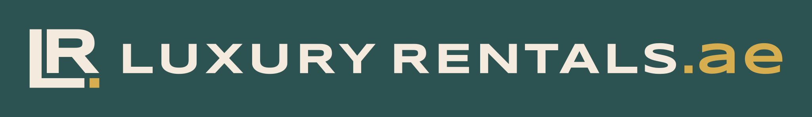
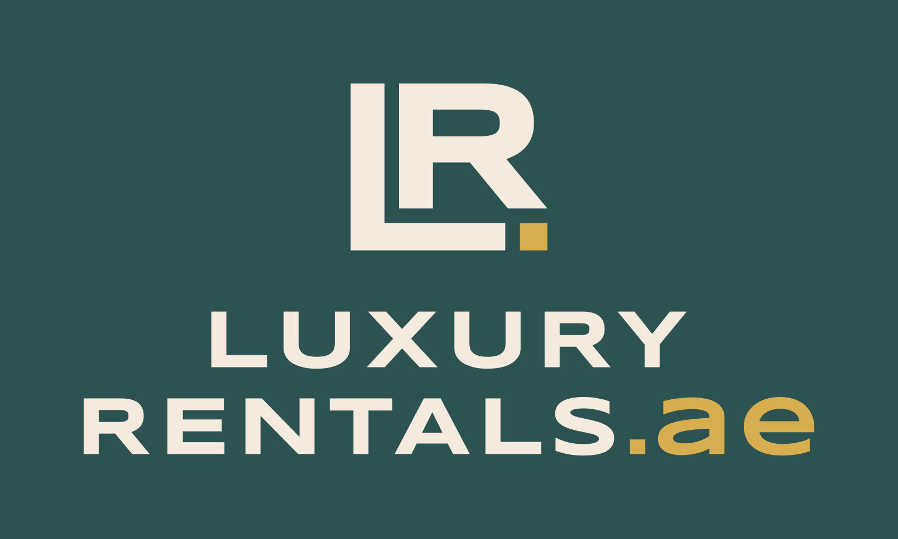
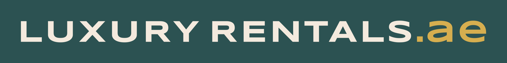
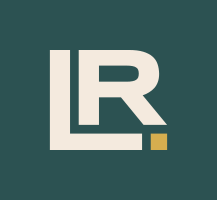
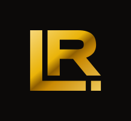

# LuxuryRental.ae logo: usage sheet

Version 1, 23 Oct 2026. Direction "Corner". The wordmark text "LuxuryRental.ae" was approved by the client (plan-answers Q1). The trade name "Luxuryrentals" stays in legal text only.



**The idea.** The domain is the brand, so the gold accent is the domain ending: **.ae**. The monogram repeats that full stop. An **L** holds a smaller **R** in its corner, and a gold square closes the corner where the L's foot stops: "LR.". All letters are Syncopate Bold outlines (SIL OFL 1.1, modified), so the logo matches the site's headline face. It uses no wings, shields, animals, tridents, crowns, laurels or car shapes.

## Variants

| Variant | File | Use |
|---|---|---|
|  | `logo-horizontal.svg` | Primary. Site header and footer, documents, email signature |
|  | `logo-stacked.svg` | Square and portrait spaces: social covers, merch, the end card of a video |
|  | `wordmark.svg` | When the monogram is already on screen (app bar next to an avatar) |
|  | `monogram.svg` | Favicon, app icon, WhatsApp and Instagram avatars, watermark |
|  | `monogram-metallic.svg` | Extra only: print foil mock-ups, launch visuals. Never the primary mark |

The primary files are ivory letters with gold accents on `#0C0A09`. The black panel already includes the clear space. The single-colour files have a transparent background and no padding:

| White `#FAFAF9` | Black `#0C0A09` | Gold `#CA8A04` |
|---|---|---|
| `logo-horizontal-white.svg`, `monogram-white.svg` | `logo-horizontal-black.svg`, `monogram-black.svg` | `logo-horizontal-gold.svg`, `monogram-gold.svg` |
| Photos and dark surfaces where the gold would get lost | Light backgrounds, documents, one-colour print | Embossing, foil, gold-on-black signage |

**Icons and raster files** (all in `public/brand/`): `favicon.svg` (16 px grid cut), `favicon.ico` (16 + 32), `apple-touch-icon.png` (180, on `#0C0A09`), `icon-192.png` and `icon-512.png` (maskable, mark inside the 80% safe zone), `avatar-640.png` (survives a circle crop) and `og-template.png` (1200×630). The app wires `src/app/[lang]/icon.svg` and `src/app/[lang]/apple-icon.png` through Next's metadata file conventions.

## Colour

| Role | Hex | Notes |
|---|---|---|
| Letters | `#FAFAF9` ivory | `currentColor` in the inline React component |
| Accent: ".ae" and the monogram square | `#CA8A04` gold | Always flat. `#EAB308` is only a hover colour and a metallic highlight |
| Ground | `#0C0A09` | The logo is designed dark-first |

Only the full-colour version uses two colours. On light backgrounds, use the black version: gold on white is only 2.9:1, which is too faint for the ".ae".

## Clear space and minimum size

- **Clear space:** half the monogram's height on every side. In the horizontal lockup that equals the wordmark's cap height. Keep text, edges and other logos out of it.
- **Minimum sizes:** horizontal lockup and wordmark **120 px** wide (prefer 180 px or more; the header uses 206–290 px). Stacked lockup **100 px** wide. Monogram **16 px**. Below 24 px, use the hand-fitted favicon cut (`favicon.svg`), not a scaled-down monogram.
- **Lockup proportions** are fixed: the monogram is 2× the wordmark's cap height (3× in the stacked lockup), with a 0.8 cap-height gap. Do not rebuild the lockup by hand. Use the files.

## In code

```tsx
import { Logo } from "@/components/brand/Logo";
<Logo />          // horizontal lockup, ivory (currentColor) + gold, responsive width
<Logo compact />  // monogram only
<Logo className="w-40 text-fg" />  // a className replaces the default size classes
```

The component renders inline outlined SVG with `role="img"` and the accessible name "LuxuryRental.ae". It never mirrors in RTL. An Arabic lockup is reserved for Phase 2. It will sit beside the Latin lockup, not replace it.

## Don'ts

- Don't retype the logo in a live font, change the tracking or swap ".ae" for ".AE".
- Don't recolour parts, add gradients (except the metallic extra), glows, outlines or shadows.
- Don't stretch, skew, rotate or rearrange the monogram, wordmark or square.
- Don't put the full-colour logo on light or busy backgrounds. Use a single-colour version or the black panel.
- Don't add taglines inside the clear space, or put the logo next to car makers' logos.
- Don't use the metallic version as the main logo, or at sizes below 64 px.

## Source and rebuilding

`docs/brand/source/brandkit.py` is the editable source. It sets every outline from Syncopate Bold (from Google Fonts) with fontTools: tracking, kerning, the monogram construction, lockup ratios and the 16 and 32 px favicon cuts. `opt.mjs` runs SVGO, and `logo-master.svg` puts every variant on one artboard for Figma or Illustrator. If you change the source, regenerate the files. Don't edit the paths in `public/brand/` or `Logo.tsx` by hand.
